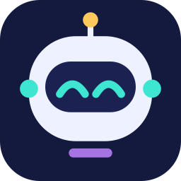

<p align="center"></p>

<h1 align="center">Agentrise</h1>

一栋放在 Mac 桌面上的小写字楼：每个编程 agent 会话都是一个在上班的机器人。
读文件时去档案室，跑命令时去机房，需要你回复时到 CEO 办公室门口等，跨楼层坐电梯。

> 当前状态：早期版本。已支持 Claude Code 与 Codex，计划支持 WorkBuddy、DeepSeek Harness。

## 楼里各房间的含义

| 房间 | 含义 |
|---|---|
| 工位区 | 写代码 |
| 档案室 | 读文件、搜索 |
| 机房 | 跑命令 |
| 情报室 | 上网查资料 |
| 白板 | 做计划 |
| 会议室 | 派活给子 agent，或等它们做完 |
| CEO 办公室 | 等你回复，或做完后汇报 |
| 茶水间 | 做完了，休息中 |
| 睡眠舱 | 闲置的会话 |

机器人身上灯条的颜色代表职级，由模型决定；每个会话有自己的团队色。

## 环境要求

- macOS 15 及以上
- Swift 6 工具链（Xcode 16 或 Command Line Tools）

## 构建与运行

```sh
scripts/build-app.sh          # 生成 build/Agentrise.app
open build/Agentrise.app
```

然后打开 **设置 → Agent 接入 → Claude Code → 安装 Hooks**。写入前会先展示改动后的
`~/.claude/settings.json`，并备份原文件；只会添加 Agentrise 自己的异步 hook，卸载时也只删这几条。

### Codex

本机有 `~/.codex/` 时，设置里才会出现 Codex 一行（已在 Codex CLI 0.164 上实测）。

1. **设置 → Agent 接入 → Codex → 安装 Hook**。写入前会先展示改动后的 `~/.codex/hooks.json`，
   并备份原文件；只添加 Agentrise 自己的条目，不会直接改 `config.toml`。
2. Codex 要求先信任新 hook 才会运行它。Agentrise 会问要不要**替我确认**：同意后通过 Codex 自己的
   `app-server` 代为信任，和在 Codex 的 `/hooks` 界面里点信任是同一条路。不同意或代为信任失败时，
   在 Codex 里输入 `/hooks`，信任 Agentrise 的几条 hook 即可。
3. 新开一个 Codex 会话才会带上这个 hook，已经开着的会话不会。
4. 收到第一个 Codex 事件后，这一行显示 **✓ 已生效**。

Codex 给的信息比 Claude Code 少，所以 Codex 的机器人不会显示：外包（后台命令）、上网查资料、发飞书。
`codex exec` 这类无界面运行不显示。Codex 退出 TUI 时不会通知 Agentrise，所以做完的 Codex 机器人
不会自己离开大楼，而是留在楼里（之后去睡眠舱）。

`swift test` 运行测试；`swift run agentrise-sim story` 会向正在运行的 App 发送一组模拟会话。
修改 `assets/*.svg` 后，运行 `swift scripts/make-icons.swift` 重新生成 PNG 和 `Resources/AppIcon.icns`。

## Windows（实验性）

有一个实验性的 Windows 版：同一栋楼、同样的会话和美术，放在一个窗口里，带托盘图标。
它**没有签名**，在真机上测得还很少。

**下载。** 发布后，[Releases](https://github.com/colin-tay/agentrise/releases) 页面上会有
`Agentrise-windows-x64-<版本>.zip`。没有安装程序：解压到任意目录，双击 `Agentrise.exe` 即可。
Swift 和 Visual C++ 运行库的 DLL 就放在它旁边，不需要另装任何东西。（如果 Windows 仍提示缺少
`VCRUNTIME140.dll` 或 `MSVCP140.dll`，请安装微软官方的
[Visual C++ 2015–2022 x64 可再发行组件包](https://aka.ms/vs/17/release/vc_redist.x64.exe)。）

**首次运行。**

- **SmartScreen** 会拦下没见过的未签名程序（"Windows 已保护你的电脑"）。点 **更多信息 → 仍要运行**。
- **智能应用控制**（Smart App Control）会直接拦截未签名程序，没有放行的按钮。它开着的话，这个版本
  启动不了。在 **设置 → 隐私和安全性 → Windows 安全中心 → 应用和浏览器控制 → 智能应用控制** 里查看
  它的状态。

**能用的功能。** 大楼窗口（横屏、竖屏）和待处理面板；托盘图标显示等你的数量，有会话开始等你时闪烁；
在托盘菜单的 **设置…** 里给 Claude Code 和 Codex 安装 hook（先预览、再备份原文件；hook 会复制到
`%LOCALAPPDATA%\Agentrise\bin\`，之后移动解压目录不影响）；职级；开机自启；窗口置顶；单实例；
单击机器人跳回对应的会话。

**已知限制。**

- 没有签名（见上）。只有 x64；Windows 11 ARM 上通过系统的 x64 模拟运行。
- 单击终端会话只把终端窗口切到前台，切不到具体标签页。跳到 Claude 桌面端会话用的是 `claude://`
  链接，在 Windows 上还没验证过。
- Windows 版没有 Bark 推送和提示音。
- 嵌在文字里的 emoji（名牌上的 ⚡）比 macOS 上小约 20%。
- 下面这些只通过读代码和文档确认过，还没在真机上试过：不支持 hook `args` 字段的旧版 Claude Code、
  Codex 执行 hook 用的 shell 和它的信任流程、npm 装的 Codex、跨显示器的 DPI 变化、以管理员身份运行。

遇到问题？请[提一个 Windows issue](https://github.com/colin-tay/agentrise/issues/new?template=windows.yml)。

## 隐私

hook 程序只在本机运行，通过只有当前用户能访问的 Unix socket 发送事件。它会丢掉 prompt 原文和文件内容，
命令、工具说明和最后一条回复只保留很短的片段。除非你开启可选的 Bark 推送，否则数据不会离开本机。

## 可选集成

- **Bark**：你离开电脑时，把「做完了 / 等你回复 / 出错」推送到 iPhone。
- **cc-connect（飞书）**：默认关闭；开启后，会把通过飞书转发的会话标注出来。

## 许可证

[MIT](LICENSE) © 2026 Colin Tay
